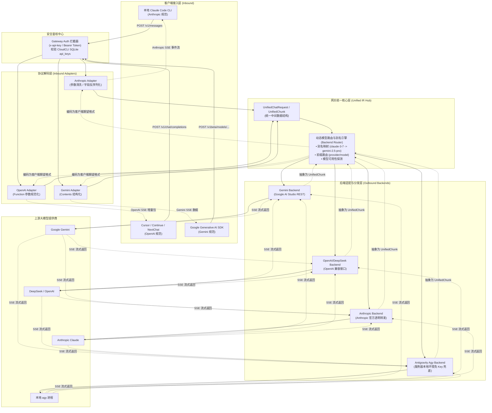
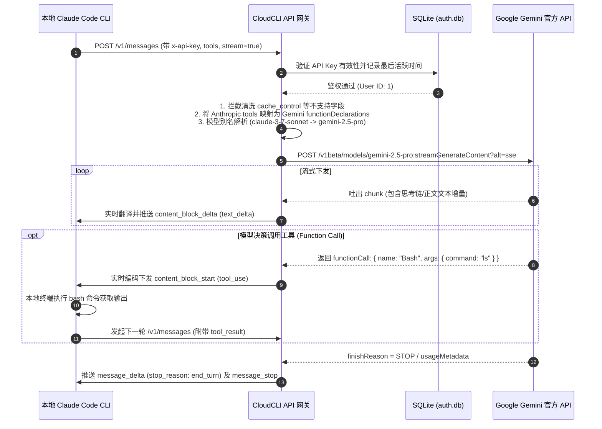
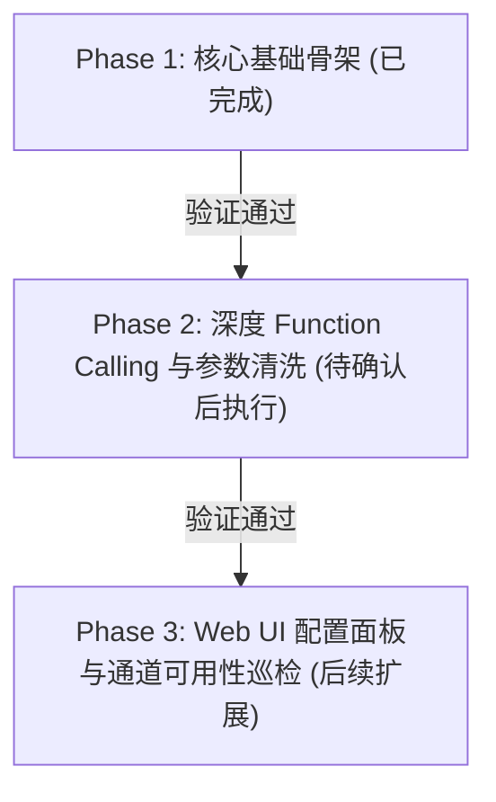

# LiteLLM 式多协议大模型转换网关设计与落地方案

## 一、方案背景与业务目标

### 1.1 业务核心诉求
在现代 AI 原生开发体系中，开发者往往使用多种客户端工具（如 Anthropic 的 **Claude Code CLI**、OpenAI 规范的 **Cursor / Continue / Cherry Studio** 等），并希望按需连接不同性价比和特长的大模型（如 **Google Gemini 2.5 Pro / Flash**、**DeepSeek-V3 / R1**、**OpenAI GPT-4o** 以及服务器本地免配置的 **Antigravity agy 引擎**）。

然而，各大模型厂商之间的协议互不兼容：
- **通信协议不一致**：Anthropic 采用 `/v1/messages` 及特定的 SSE 事件帧结构（`content_block_delta` 等），而 OpenAI 采用 `/v1/chat/completions` 及 `choices[0].delta` 结构，Google 则使用 `/v1beta/models/...:streamGenerateContent`。
- **工具调用（Tool Calling / Function Calling）格式差异大**：Claude Code 作为本地自主 Coding Agent，其运作完全依赖高频的 `tool_use` 与 `tool_result` 循环；若协议转换不彻底，本地 Agent 循环便会直接中断。
- **高级特性差异**：Anthropic 的 Prompt Caching（`cache_control`）、Extended Thinking（思考链预算）等专有字段直接传递给其他模型会触发 400 校验异常。

### 1.2 目标定位
本项目旨在**将 CloudCLI 原生扩展为企业级的轻量化多协议大模型转换网关（类似内置的 LiteLLM-Proxy）**：
1. **统一接入端点**：直接复用当前服务的 3001 端口，无需额外开放防火墙端口或启动独立代理进程。
2. **Any-to-Any 全双工协议转译**：支持任意入站协议（Anthropic / OpenAI / Gemini）与任意出站目标提供商的实时双向翻译。
3. **Agent 级工具调用闭环**：完整保障 Claude Code CLI 等本地智能体在 Gemini / DeepSeek 上的本地执行与文件读写能力。
4. **统一鉴权与管理**：复用现有的 API Key 体系，支持动态配置上游 Key、模型别名与路由规则。

---

## 二、总体架构与业务闭环设计

系统基于 **Hub & Spoke（中心轴辐射）** 架构设计，引入统一中间表示层（Unified IR），避免 $O(N^2)$ 的点对点适配维护地狱：



### 业务闭环执行时序
以本地 **Claude Code CLI 调用网关中转的 Google Gemini 模型** 为例，完整业务闭环流转如下：



---

## 三、核心技术实现方案

### 3.1 跨协议 Function Calling / Tool Use 双向映射机制

这是保证 Claude Code、Cursor Agent 能够正常操作本地文件和终端的关键核心：

| 规范 | 请求中的工具定义 (Definition) | 模型触发工具调用 (Invocation) | 客户端回传工具结果 (Result) |
| :--- | :--- | :--- | :--- |
| **Anthropic** | `tools: [{ name, description, input_schema }]` | `content: [{ type: "tool_use", id, name, input }]` | `content: [{ type: "tool_result", tool_use_id, content }]` |
| **OpenAI** | `tools: [{ type: "function", function: { name, description, parameters } }]` | `tool_calls: [{ id, type: "function", function: { name, arguments: "{...}" } }]` | `role: "tool", tool_call_id, content` |
| **Gemini** | `tools: [{ functionDeclarations: [{ name, description, parameters }] }]` | `parts: [{ functionCall: { name, args: {...} } }]` | `parts: [{ functionResponse: { name, response: {...} } }]` |

#### 网关映射规则：
1. **Schema 转换**：
   - Anthropic 的 `input_schema` 原生为 JSON Schema，直接对应 OpenAI 的 `parameters` 以及 Gemini 的 `parameters`。
   - 剔除 Gemini API 不支持的复杂 JSON Schema 关键字（如 `$schema`、`additionalProperties` 等），避免上游 400 校验拦截。
2. **ID 保持与模拟**：
   - Anthropic 依赖 `tool_use_id`（如 `toolu_01...`）关联结果，而 Gemini 原生 `functionCall` 不携带 ID。
   - 网关在接收到 Gemini `functionCall` 时，自动生成带时间戳与随机数的关联 ID（如 `call_gemini_xxx`），并在工具结果回传时还原对应关系。

### 3.2 SSE 流式事件帧状态机

网关采用**零缓冲实时管道**，维护流式转换状态机：

```
       [开始连接]
           │
           ▼
    emit(message_start)
           │
           ├───────────────► 遇到 Thinking 内容 ──► emit(content_block_start: thinking)
           │                                          │  emit(content_block_delta: thinking_delta)
           │                                          ▼  emit(content_block_stop)
           │
           ├───────────────► 遇到 Text 内容     ──► emit(content_block_start: text)
           │                                          │  emit(content_block_delta: text_delta)
           │                                          ▼  emit(content_block_stop)
           │
           ├───────────────► 遇到 ToolCall 内容 ──► emit(content_block_start: tool_use)
           │                                          │  emit(content_block_delta: input_json_delta)
           │                                          ▼  emit(content_block_stop)
           │
           ▼
    emit(message_delta: stop_reason, usage)
           │
           ▼
    emit(message_stop)
```

### 3.3 参数兼容清洗与模型别名体系

1. **Prompt Caching 兼容**：
   - Claude Code 默认携带 `cache_control: {"type": "ephemeral"}`。
   - 网关入站解码时识别并在转发给非 Anthropic 上游前自动剥离，防止报错。
2. **Extended Thinking 适配**：
   - Anthropic 请求中的 `thinking: { type: "enabled", budget_tokens: 2048 }`；
   - 路由到 Gemini 时自动转换为 Gemini 2.5 的思考配置；
   - 路由到 DeepSeek 时自动转换为 DeepSeek-R1 的推理模式并捕获 `reasoning_content`。
3. **模型别名配置（Model Aliasing）**：
   - 支持在配置中定义别名映射表：
     ```json
     {
       "claude-3-7-sonnet-20250219": "gemini-2.5-pro",
       "claude-3-5-sonnet-20241022": "gemini-2.5-flash",
       "gpt-4o": "deepseek-chat"
     }
     ```
   - 客户端即使写死请求 `claude-3-7-sonnet-20250219`，网关在转发时自动替换为目标模型，在回包时依然标注为请求的模型名，确保客户端校验通过。

---

## 四、配置规范与持久化机制

网关提供**环境变量优先、数据库持久化兜底**的双层配置机制，支持无重启热更新：

### 4.1 环境变量配置（`.env`）
```bash
# 网关统一访问凭证（可选，若不配置则使用 CloudCLI 的 API Keys）
GATEWAY_API_KEY=your_custom_gateway_key

# 默认转发目标模型
GATEWAY_DEFAULT_MODEL=gemini-2.5-pro

# 上游提供商凭据
GEMINI_API_KEY=AIzaSy...
GEMINI_BASE_URL=https://generativelanguage.googleapis.com

DEEPSEEK_API_KEY=sk-...
DEEPSEEK_BASE_URL=https://api.deepseek.com

OPENAI_API_KEY=sk-...
OPENAI_BASE_URL=https://api.openai.com/v1

ANTHROPIC_API_KEY=sk-ant-...
ANTHROPIC_BASE_URL=https://api.anthropic.com
```

### 4.2 数据库存储配置（`app_config` 表）
所有可在 Web 端配置的参数持久化于 SQLite 的 `app_config` 表中，键名以 `gateway.` 为命名空间：
- `gateway.gemini_api_key`
- `gateway.deepseek_api_key`
- `gateway.openai_api_key`
- `gateway.anthropic_api_key`
- `gateway.model_aliases`（JSON 字符串）
- `gateway.default_model`

### 4.3 管理端接口
- `GET /api/gateway/config`：读取脱敏后的配置信息及当前可用模型列表。
- `POST /api/gateway/config`：热更新网关配置，立即生效无需重启 Node 服务。

---

## 五、全场景接入实践指南

### 5.1 场景一：本地 Claude Code CLI 对接服务器中转的 Gemini
1. **服务器端准备**：在服务器 `.env` 或网关管理配置中填入 `GEMINI_API_KEY`。
2. **本地终端配置**：
   ```bash
   # 配置 Claude Code 指向云端网关
   export ANTHROPIC_BASE_URL="http://japan.bleem.site:3001"
   export ANTHROPIC_API_KEY="ck_48490166428cd9fdf5046a786db1cea37aaefaf0b8ed8128829f16450e5c73bd"

   # 启动 Claude Code
   claude
   ```
3. **运行效果**：本地终端的所有提问、代码修改、Bash 工具调用均由服务器中转至 Gemini 2.5 Pro 运算，并在本地顺畅执行。

### 5.2 场景二：Cursor / VSCode Continue 接入 DeepSeek / Gemini
1. **客户端设置**：
   - **OpenAI Base URL**：`http://japan.bleem.site:3001/v1`
   - **API Key**：`ck_48490166428cd9fdf5046a786db1cea37aaefaf0b8ed8128829f16450e5c73bd`
   - **Model Name**：`deepseek-chat` 或 `gemini-2.5-pro`
2. **运行效果**：代码自动补全、行内编辑及 Agent 模式均享受极速流式回传。

### 5.3 场景三：零外部 API Key 的本地 agy 兜底模式
1. 当服务器未配置任何公网 API Key 时，网关自动探测本地环境中的 Antigravity `agy` 引擎。
2. 请求自动降级由本地已授权的 `gemini-3.8-flash-high` 执行，无需任何外部 API 费用。

---

## 六、实施计划与阶段检查点（Milestones）



- **Phase 1（当前已完成）**：
  - [x] 多协议路由挂载（`/v1/messages`, `/v1/chat/completions`, `/v1/models`, `/v1beta/...`）。
  - [x] 统一 API Key 鉴权中间件。
  - [x] Anthropic / OpenAI / Gemini 基础请求与响应适配。
  - [x] 本地 `agy` 零配置引擎集成与真实流式测试验证。
  - [x] 单元测试通过并完成初始代码提交推送。

- **Phase 2（待用户确认后执行的下一步重点）**：
  - [ ] **完善 Function Calling 跨协议完整转译**：在 Gemini 与 OpenAI backend 中增加针对 `tool_use` 与 `tool_result` 的结构互转与校验，确保 Claude Code CLI 的本地工具调用无缝闭环。
  - [ ] **参数自动清洗过滤器**：全面过滤 `cache_control` 及不兼容的嵌套 Schema 字段。
  - [ ] **配置读取优先级优化**：打通环境变量、数据库配置与热更新。

- **Phase 3（后续扩展）**：
  - [ ] CloudCLI 前端设置页面中增加“API 网关配置”可视化面板，支持在浏览器中一键填写/修改各大模型 Key、自定义别名规则及查看各通道调用统计。
