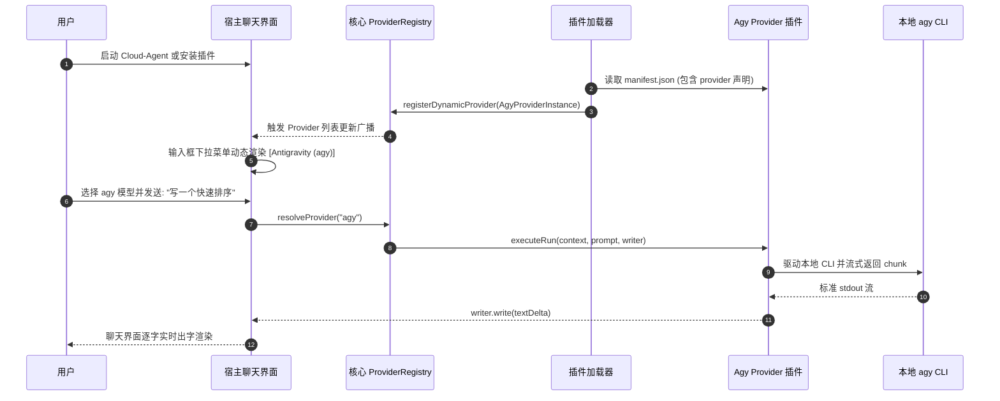

# 本地 agy 插件化与 Provider 扩展架构方案

## 1. 概述与背景

在前期工作中，系统成功完成了 **Google Antigravity (`agy` CLI)** 与本地 API 网关的深度适配，实现了：
- LiteLLM 式多协议统一网关（兼容 OpenAI、Anthropic、Gemini 协议）；
- `agy` 本地进程的参数映射、元数据与内部 Harness 提示词清洗；
- 会话连续性追踪（Session Continuity Manager）以及连续 10 轮拟人化上下文无缝交互。

目前，该功能是以**系统内置（Built-in Core）**的方式硬编码在 `server/modules/gateway/` 和 `server/modules/providers/list/agy/` 中。为了提升系统的解耦性、降低主干代码的维护成本，并方便将此项能力独立分发给其他 CloudCLI / Cloud-Agent 用户，本文档提出了**将本地 `agy CLI` 对接能力重构为独立插件**的技术落地全景方案，并针对**方案 A（零内核侵入式插件）**与**方案 B（内核扩展型 Provider 插件）**进行了深度的功能展开、架构图绘制与分步落地指南。

---

## 2. 现有插件体系机制与边界分析

通过对项目源码（`server/modules/plugins/` 和 `src/modules/plugins/`）的深度审查，当前 Cloud-Agent 的插件架构具备以下特征与约束：

```mermaid
flowchart TD
    subgraph Host["Cloud-Agent 宿主环境 (:3001)"]
        Frontend["Web 前端 (React SPA)"]
        PluginTab["PluginTabContent (Blob URL 动态 import)"]
        Server["Express 宿主网关"]
        PluginService["PluginService (~/.claude-code-ui/plugins)"]
        ProxyRouter["RPC 代理 (/api/plugins/:name/rpc)<br>WS 代理 (/plugin-ws/:name)"]
    end

    subgraph Plugin["独立插件进程"]
        Manifest["manifest.json (清单声明)"]
        UI["前端 ESM (mount / unmount)"]
        Process["后端独立子进程 (Node.js)"]
    end

    Frontend -->|点击 Tab 标签页| PluginTab
    PluginTab -->|拉取资源 Blob 动态执行| UI
    UI -->|hostApi.rpc()| ProxyRouter
    ProxyRouter -->|内部反向代理| Process
    Frontend -->|WebSocket 连接| ProxyRouter
    ProxyRouter -->|ws://127.0.0.1:port/ws| Process
    Server -->|spawn 进程生命周期与握手| Process
```

### 2.1 现有插件机制的核心能力
1. **沙箱式目录结构**：插件独立存放在 `~/.claude-code-ui/plugins/<plugin-name>/`，配置持久化于 `~/.claude-code-ui/plugins.json`。
2. **前端 ESM 动态装载**：宿主通过 Blob URL 原生 `import()` 载入插件前端产物，提供 `mount(container, hostApi)` 和 `unmount(container)` 契约。
3. **子进程生命周期与 10 秒握手**：
   - 宿主使用 `cross-spawn` 运行插件的 `server` 入口；
   - 插件进程必须在 10 秒内向 `stdout` 输出单行 JSON：`{"ready": true, "port": <port>}`；
   - 宿主动态捕获端口，实现进程自动拉起与崩溃自愈。
4. **透明网络转发**：
   - **HTTP RPC**：自动将 `/api/plugins/:name/rpc/*` 转发到 `http://127.0.0.1:<port>/*`，并自动注入配置好的 Header 密钥（`x-plugin-secret-<key>`）；
   - **WebSocket**：将 `/plugin-ws/:name` 双向透明桥接至 `ws://127.0.0.1:<port>/ws`；
   - **Skills 自动分发**：插件根目录若包含 `skills/` 或 `commands/`，宿主会自动加载其中的 Markdown 定义并注册为 Slash Commands。

### 2.2 现有插件机制的局限性
- **UI 插槽单一**：当前 `manifest.json` 仅支持 `"slot": "tab"`，即只能以工作区主标签页形式呈现，**无法直接将自身注入为主聊天界面的原生 Provider 下拉选项**（目前 Provider 由 `provider.registry.ts` 静态注册）。
- **顶级路由受限**：插件的 HTTP 请求被限制在宿主的 `/api/plugins/:name/rpc/*` 前缀下，无法直接劫持顶级的 `/v1/chat/completions` 或 `/v1/messages`。

---

## 3. 方案 A 深度展开：基于现有规范的独立 Agy 插件（零内核侵入）

### 3.1 方案定位与全景架构图
**方案 A** 的核心理念是**“绝对解耦、零修改宿主代码”**。完全遵循当前 Cloud-Agent 既有的插件规范，通过在插件后端内部实现**“双服务通道”**（宿主握手通道 + 独立网关端口），既能作为 UI Tab 提供可视化控制台，又能为外部 CLI 提供标准的 LLM API。

```mermaid
flowchart TB
    subgraph External["外部客户端"]
        ClaudeCode["Claude Code CLI (ANTHROPIC_BASE_URL:3002)"]
        OpenAIClient["第三方 OpenAI SDK (BASE_URL:3002)"]
    end

    subgraph HostApp["Cloud-Agent 宿主系统 (:3001)"]
        HostUI["宿主主界面 / Tab 容器"]
        HostProxy["宿主插件代理 (/api/plugins/cloudcli-plugin-agy/rpc)"]
    end

    subgraph PluginProcess["cloudcli-plugin-agy 插件子进程"]
        subgraph FrontEnd["前端 ESM (dist/index.js)"]
            TabUI["Agy 可视化控制面板<br>(版本探测/模型切换/日志查看)"]
        end
        
        subgraph BackEnd["后端服务 (server/index.js)"]
            RPCHandler["宿主内部通信服务 (:DynamicPort)<br>响应握手与控制指令"]
            GatewayServer["独立多协议网关服务 (:3002)<br>/v1/chat/completions & /v1/messages"]
            PromptScrubber["元数据与 XML Harness 清洗器"]
            SessionManager["会话连续性保持映射器"]
            AgyDriver["Agy 本地 CLI 驱动器"]
        end
    end

    subgraph System["操作系统本地环境"]
        AgyCLI["Google Antigravity 本地命令行 (agy)"]
    end

    HostUI -->|加载与渲染| TabUI
    TabUI -->|hostApi.rpc()| HostProxy
    HostProxy -->|内部转发| RPCHandler
    RPCHandler <--> GatewayServer
    
    ClaudeCode -->|直连原生网关端口| GatewayServer
    OpenAIClient -->|直连原生网关端口| GatewayServer

    GatewayServer --> PromptScrubber
    PromptScrubber --> SessionManager
    SessionManager --> AgyDriver
    AgyDriver -->|执行并监听 SSE| AgyCLI
```

---

### 3.2 方案 A 核心功能矩阵

| 功能模块 | 功能描述 | 解决的核心问题与技术实现 |
| :--- | :--- | :--- |
| **双端口微服务架构** | 插件子进程同时监听宿主握手端口与外部网关独立端口（如 `3002`） | 突破宿主 `/api/plugins/:name/rpc` 的路径限制，让 Claude Code 等工具直接配置标准 Base URL |
| **智能 Harness 清洗** | 自动剥离 Claude Code 注入的 500+ 行 XML 约束标签（`<guidelines>`、`<tools>`） | 防止底层 Gemini / Agy 模型将客户端脚手架判定为提示注入而拒绝输出内容 |
| **流式中断与保底** | 监听 `agy` 的 `result` 事件后主动发送 `[DONE]` 并立即销毁流管道 | 彻底解决“输出结束后终端持续挂起直至超时”与“1 Token 空内容”异常 |
| **会话连续性维持** | 插件本地维护 `SessionId` 与 `ConversationId` 的映射文件 | 确保连续问答命中同一本地 agy 会话，实现 10+ 轮拟人化记忆与代数推导 |
| **可视化控制面板** | 前端 Tab 提供版本状态、活跃模型选择、实时日志与耗时监控 | 赋予用户直观掌控本地引擎的能力，支持一键切换 `gemini-3.8-flash-low` 与 `claude-sonnet-4-6` |
| **Slash 技能下发** | 插件内打包 `skills/agy.md`，宿主自动解析 | 用户在宿主任何会话输入 `/agy` 即可唤出专用指令与工具指南 |

---

### 3.3 方案 A 分步实现指南

#### 步骤 1：创建插件目录与清单 (`manifest.json`)
在独立代码仓库中创建标准清单，注意 `slot` 设为 `"tab"`，`server` 指定后端入口：
```json
{
  "name": "cloudcli-plugin-agy",
  "displayName": "Google Antigravity Gateway",
  "version": "1.0.0",
  "description": "本地 Google agy CLI 桥接引擎与多协议 API 网关",
  "icon": "Cpu",
  "type": "module",
  "slot": "tab",
  "entry": "dist/index.js",
  "server": "server/index.js",
  "permissions": ["network", "storage"],
  "repository": "https://github.com/your-username/cloudcli-plugin-agy"
}
```

#### 步骤 2：实现后端子进程与双通道监听 (`server/index.js`)
在插件后端中同时拉起宿主 RPC 接口与外部 API 网关端口：
```javascript
import http from 'http';
import { WebSocketServer } from 'ws';
import { handleAgyChatCompletion, handleAgyAnthropicMessage } from './gateway-engine.js';
import { getAgyStatus, listActiveSessions } from './session-manager.js';

const GATEWAY_PORT = process.env.AGY_GATEWAY_PORT || 3002;

// 1. 外部独立网关服务（提供标准的 /v1 接口）
const gatewayApp = http.createServer(async (req, res) => {
  res.setHeader('Access-Control-Allow-Origin', '*');
  res.setHeader('Access-Control-Allow-Headers', '*');
  if (req.method === 'OPTIONS') return res.writeHead(200).end();

  const url = new URL(req.url, `http://localhost:${GATEWAY_PORT}`);
  
  if (url.pathname === '/v1/chat/completions') {
    return handleAgyChatCompletion(req, res);
  }
  if (url.pathname === '/v1/messages') {
    return handleAgyAnthropicMessage(req, res);
  }
  if (url.pathname === '/v1/models') {
    res.writeHead(200, { 'Content-Type': 'application/json' });
    return res.end(JSON.stringify({
      object: 'list',
      data: [
        { id: 'agy/gemini-3.8-flash-low', owned_by: 'antigravity' },
        { id: 'agy/gemini-3.8-flash-high', owned_by: 'antigravity' },
        { id: 'agy/claude-sonnet-4-6', owned_by: 'antigravity' }
      ]
    }));
  }

  res.writeHead(404).end('Not Found');
});

gatewayApp.listen(GATEWAY_PORT, '127.0.0.1', () => {
  console.log(`[Plugin-Agy] Public Gateway listening on http://127.0.0.1:${GATEWAY_PORT}`);
});

// 2. 宿主内部 RPC 服务（用于满足宿主 10 秒握手和前端 Tab 通信）
const rpcServer = http.createServer((req, res) => {
  const url = new URL(req.url, 'http://localhost');
  if (url.pathname === '/status') {
    res.writeHead(200, { 'Content-Type': 'application/json' });
    return res.end(JSON.stringify(getAgyStatus()));
  }
  if (url.pathname === '/sessions') {
    res.writeHead(200, { 'Content-Type': 'application/json' });
    return res.end(JSON.stringify(listActiveSessions()));
  }
  res.writeHead(404).end();
});

// 宿主 WebSocket 实时日志流
const wss = new WebSocketServer({ server: rpcServer, path: '/ws' });
wss.on('connection', (ws) => {
  ws.send(JSON.stringify({ type: 'ready', gatewayPort: GATEWAY_PORT }));
});

// 3. 动态端口绑定并执行宿主握手协议
rpcServer.listen(0, '127.0.0.1', () => {
  const rpcPort = rpcServer.address().port;
  // 向标准输出输出指定格式的 JSON 字符串完成握手
  console.log(JSON.stringify({ ready: true, port: rpcPort }));
});
```

#### 步骤 3：编写前端控制面板组件 (`src/index.tsx`)
利用宿主传递的 `hostApi` 挂载可视化控制台：
```tsx
import React, { useEffect, useState } from 'react';
import ReactDOM from 'react-dom/client';

let root: ReactDOM.Root | null = null;

function AgyDashboard({ hostApi }: { hostApi: any }) {
  const [status, setStatus] = useState<any>(null);

  useEffect(() => {
    // 调用内部 RPC 获取后端运行状态
    hostApi.rpc('GET', '/status').then(setStatus).catch(console.error);
  }, []);

  return (
    <div className="p-6 max-w-4xl mx-auto space-y-6">
      <h2 className="text-2xl font-bold flex items-center gap-2">
        <span>⚡</span> Google Antigravity 本地控制面板
      </h2>
      <div className="grid grid-cols-2 gap-4">
        <div className="p-4 border rounded shadow-sm">
          <div className="text-sm text-gray-500">网关监听端口</div>
          <div className="text-xl font-mono mt-1">127.0.0.1:3002</div>
        </div>
        <div className="p-4 border rounded shadow-sm">
          <div className="text-sm text-gray-500">CLI 运行状态</div>
          <div className="text-xl font-semibold mt-1 text-green-600">
            {status?.installed ? '已就绪 (Ready)' : '未检测到 agy'}
          </div>
        </div>
      </div>
      <div className="p-4 bg-gray-50 dark:bg-zinc-800 rounded">
        <h4 className="font-semibold text-sm mb-2">外部终端直连配置指南：</h4>
        <pre className="text-xs bg-black text-green-400 p-3 rounded overflow-x-auto">
{`export ANTHROPIC_BASE_URL="http://127.0.0.1:3002"
export ANTHROPIC_API_KEY="sk-any-token"
claude`}
        </pre>
      </div>
    </div>
  );
}

export async function mount(container: HTMLElement, hostApi: any): Promise<void> {
  root = ReactDOM.createRoot(container);
  root.render(<AgyDashboard hostApi={hostApi} />);
}

export function unmount(container: HTMLElement): void {
  root?.unmount();
  root = null;
}
```

#### 步骤 4：本地软链与测试验证
```bash
# 1. 软链至本地插件目录
ln -s /home/yubs/cloudcli-plugin-agy ~/.claude-code-ui/plugins/cloudcli-plugin-agy

# 2. 打开浏览器访问宿主设置页面，在 Plugins 列表点击 Enable
# 3. 验证外部终端连通性
curl -N http://127.0.0.1:3002/v1/chat/completions \
  -H "Content-Type: application/json" \
  -d '{"model":"agy/gemini-3.8-flash-low","messages":[{"role":"user","content":"Hi"}],"stream":true}'
```

---

## 4. 方案 B 深度展开：增强 Cloud-Agent 核心的 Provider 扩展规范（终极演进）

### 4.1 方案定位与时序图
**方案 B** 的核心理念是**“插件即原生 Provider”**。通过轻微重构宿主内核的 `ProviderRegistry`，使插件不仅能提供 Tab 页面，还能声明自身的 `provider` 属性。宿主启动或加载插件时，动态将其注入主聊天系统的 Provider 列表，实现主聊天输入框与下拉菜单的完全原生集成。



---

### 4.2 方案 B 核心功能矩阵

| 功能模块 | 功能描述 | 核心价值与技术实现 |
| :--- | :--- | :--- |
| **Manifest 规范扩充** | 新增 `capabilities: ["provider"]` 与 `provider` 声明块 | 允许插件对外声明其提供的 Provider ID、展示名称、模型矩阵与身份认证探测方法 |
| **动态 Provider 注册表** | 改造 `provider.registry.ts`，支持 `registerDynamicProvider` | 彻底打破原生 Provider 静态硬编码限制，实现微内核架构的动态插拔 |
| **统一网关前缀路由动态挂载** | 核心 API 网关自动根据动态注册的模型列表生成路由分发器 | 外部访问 `http://127.0.0.1:3001/v1/messages` 携带 `agy/*` 时，网关自动派发至动态 Provider |
| **原生会话数据库无缝托管** | 动态 Provider 产出的消息直接写入主系统 `sessions.db` | 会话与 Claude、Cursor 会话享受完全平等的搜索、归档、导出与继续对话能力 |
| **通用模型生态拓展** | 同一套规范可无缝接入 Ollama、vLLM、LocalAI、SGLang | 成为 Cloud-Agent 对接全行业私有化与开源大模型生态的标准规范 |

---

### 4.3 方案 B 分步改造落地指南

#### 步骤 1：扩充宿主清单校验规则 (`server/modules/plugins/plugin-registry.service.ts`)
在宿主的清单校验函数中，增加对 `provider` 能力与结构的校验：
```typescript
const ALLOWED_CAPABILITIES = ['tab', 'provider', 'gateway-backend'];

export function validateManifest(manifest: any) {
  // 原有 name、displayName 等校验...
  
  if (manifest.capabilities) {
    if (!Array.isArray(manifest.capabilities) || !manifest.capabilities.every(c => ALLOWED_CAPABILITIES.includes(c))) {
      return { valid: false, error: 'Invalid capabilities declaration' };
    }
    // 若声明了 provider，校验 provider 块的合法性
    if (manifest.capabilities.includes('provider')) {
      if (!manifest.provider || typeof manifest.provider.id !== 'string') {
        return { valid: false, error: 'Provider capability requires provider.id string' };
      }
    }
  }

  return { valid: true };
}
```

#### 步骤 2：重构宿主 Provider 注册中心 (`server/modules/providers/provider.registry.ts`)
将静态字典升级为支持动态注销的注册表，并对外暴露广播接口：
```typescript
import type { IProvider } from '@/shared/interfaces.js';
import type { LLMProvider } from '@/shared/types.js';

export interface IDynamicProvider extends IProvider {
  pluginName: string;
}

const builtInProviders: Record<string, IProvider> = {
  claude: new ClaudeProvider(),
  codex: new CodexProvider(),
  cursor: new CursorProvider(),
  opencode: new OpenCodeProvider(),
};

const dynamicProviders = new Map<string, IDynamicProvider>();

export const providerRegistry = {
  // 注册动态 Provider
  registerDynamicProvider(provider: IDynamicProvider): void {
    dynamicProviders.set(provider.id, provider);
    console.log(`[Providers] Dynamic provider registered: "${provider.id}" by plugin "${provider.pluginName}"`);
  },

  // 卸载动态 Provider
  unregisterDynamicProvider(providerId: string): void {
    dynamicProviders.delete(providerId);
    console.log(`[Providers] Dynamic provider unregistered: "${providerId}"`);
  },

  // 获取完整 Provider 列表（供前端 API 和输入框渲染）
  listProviders(): IProvider[] {
    return [
      ...Object.values(builtInProviders),
      ...Array.from(dynamicProviders.values()),
    ];
  },

  resolveProvider(providerId: string): IProvider {
    if (builtInProviders[providerId]) {
      return builtInProviders[providerId];
    }
    const dynamic = dynamicProviders.get(providerId);
    if (dynamic) {
      return dynamic;
    }
    throw new Error(`Unsupported provider "${providerId}".`);
  },
};
```

#### 步骤 3：在插件服务中绑定生命周期 (`server/modules/plugins/plugins.service.ts`)
当插件被启用或禁用时，联动注册或注销对应的 Provider 实例：
```typescript
// 插件启动或启用成功后
if (manifest.capabilities?.includes('provider')) {
  const dynamicProviderInstance = createDynamicProviderAdapter({
    manifest: manifest.provider,
    pluginRpcPort: port,
  });
  providerRegistry.registerDynamicProvider(dynamicProviderInstance);
}

// 插件停止或卸载时
if (manifest.capabilities?.includes('provider')) {
  providerRegistry.unregisterDynamicProvider(manifest.provider.id);
}
```

#### 步骤 4：编写符合 Provider 规范的 agy 插件
插件的 `manifest.json` 只需声明 provider 属性：
```json
{
  "name": "cloudcli-plugin-agy",
  "displayName": "Google Antigravity",
  "capabilities": ["provider", "tab"],
  "provider": {
    "id": "agy",
    "name": "Google Antigravity (agy)",
    "models": [
      "gemini-3.8-flash-low",
      "gemini-3.8-flash-high",
      "claude-sonnet-4-6"
    ]
  },
  "entry": "dist/index.js",
  "server": "server/index.js"
}
```

---

## 5. 方案 A 与方案 B 深度对比矩阵

| 评估维度 | 方案 A：独立 Tab 控制台与独立网关端口 | 方案 B：内核扩展 Provider 动态插件 |
| :--- | :--- | :--- |
| **内核侵入性** | **零侵入**：100% 遵守宿主当前现有插件代码规范 | **轻度侵入**：需修改宿主 `provider.registry.ts` 与插件加载器约 50 行代码 |
| **主界面原生体验** | **次级体验**：以专属 Tab 标签页形式呈现，主聊天框无 `agy` 选项 | **原生极致体验**：主界面聊天框下拉列表直接出现 `agy`，体验与内置无异 |
| **外部工具接入体验** | **极佳**：通过独立的 `3002` 端口直接兼容 Claude Code 与 cURL | **原生统一**：直接复用宿主 `3001` 端口的标准统一网关，无需额外端口 |
| **开发与落地周期** | **极快**：1-2 天即可将现有 `agy.backend.ts` 打包封装完成 | **中等**：需协同宿主核心进行接口规范设计与测试评审 |
| **生态普适价值** | 仅作为一个独立的特定功能插件使用 | **极高**：为整个生态建立了第三方接入私有模型（Ollama 等）的通用工业级标准 |

---

## 6. 最终演进路径建议

1. **短期交付（方案 A 快速独立化）**：
   - 优先按照**方案 A**将现有代码封装为 `cloudcli-plugin-agy`。
   - 这样既能保留当前服务器上的内置稳定性，又能立刻向开源社区提供一个即插即用、开箱即得的独立插件仓库。
2. **长期演进（方案 B 向上游提议）**：
   - 将**方案 B**中的 `registerDynamicProvider` 机制整理为 RFC 或 PR 提交给 CloudCLI 官方代码库，推动官方支持 Provider 插件规范，完成生态层面的终极解耦。
